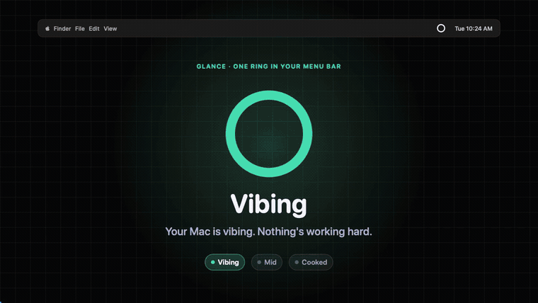
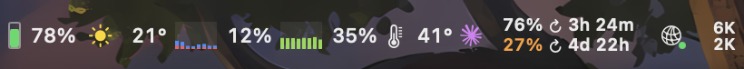
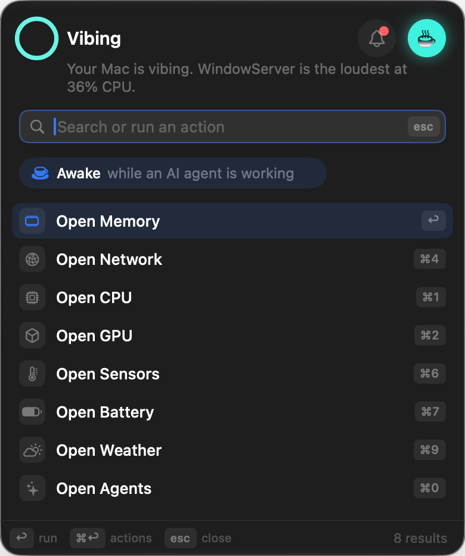
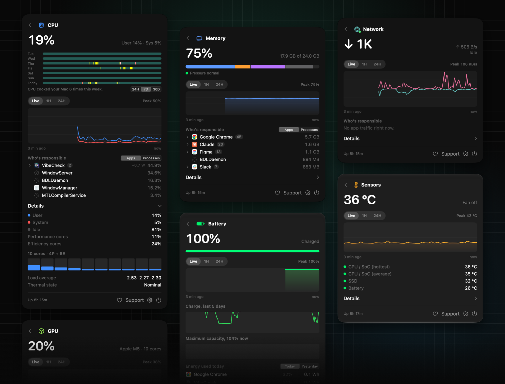
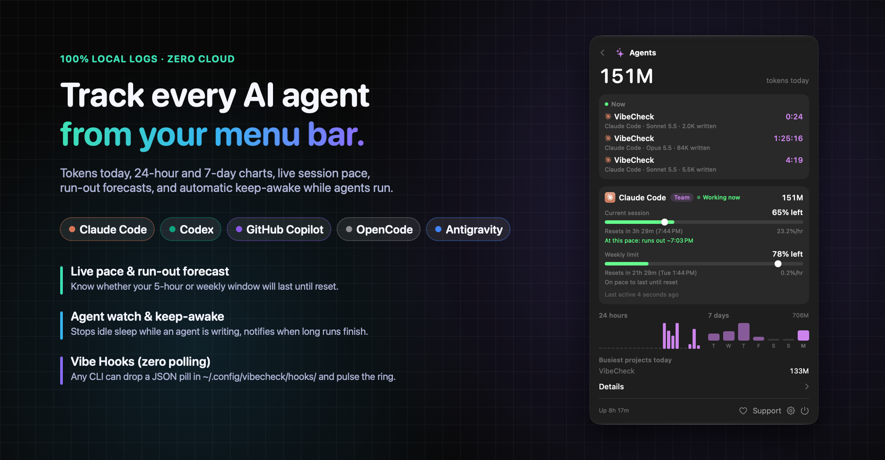

<p align="center">
  <picture>
    <source media="(prefers-color-scheme: dark)" srcset="branding/png/lockup-dark.png">
    
  </picture>
</p>

<p align="center"><strong>Mac health in one ring</strong></p>

<p align="center">
  
</p>

<p align="center">
  <a href="#install">
    
  </a>
  <br>
  <sub>Free and open source (GPL-3.0) · macOS 14 Sonoma or later ·
  <a href="https://github.com/saroj-shahi/vibecheck/releases/latest">release notes</a></sub>
</p>

<p align="center">
  <a href="https://github.com/saroj-shahi/vibecheck/releases/latest"></a>
  <a href="LICENSE"></a>
  
  <a href="https://github.com/saroj-shahi/vibecheck/actions/workflows/ci.yml"></a>
  <a href="https://buymeacoffee.com/sarojshahi"></a>
</p>

---

## Meet VibeCheck

Your fan starts screaming. The battery drops faster than it should. Everything feels slow, and you have no idea why. Normally you'd open Activity Monitor and squint at a wall of numbers.

**VibeCheck does the squinting for you.** One small ring sits in your menu bar and answers one question: _is your Mac vibing or cooked?_

<table>
  <tr>
    <td width="33%" valign="top">
      <strong>1. Glance</strong><br>
      One monochrome ring in your menu bar. Color and a short culprit badge (<code>CPU 96%</code>, <code>Memory</code>) appear only when something needs you.
    </td>
    <td width="33%" valign="top">
      <strong>2. Explain</strong><br>
      Click the ring for a plain-English verdict — <em>"Kinda mid: Xcode is the loudest at 140% CPU"</em> — plus live tiles, history charts and who's responsible.
    </td>
    <td width="33%" valign="top">
      <strong>3. Act</strong><br>
      Quit runaway apps, stop forgotten dev servers, keep your Mac awake, mute the mic, or press <code>⌘K</code> to run any command without stealing focus.
    </td>
  </tr>
</table>

### See it in action

<p align="center">
  
  <br>
  <sub>
    14-second walkthrough · <a href="docs/screenshots/demo.mp4">Watch full 720p MP4 video</a>
  </sub>
</p>

### Why you'll like it

- **Answers, not numbers.** Every view starts with one sentence about what's going on. Charts and per-core details are one click deeper.
- **Find the culprit in one click.** Helper processes are folded into their parent app so you immediately see who's eating CPU, RAM, battery or bandwidth—and quit them right there.
- **Your Mac stays awake when you need it.** Downloads, exports, presentations, or AI agents running overnight: tap the cup and your Mac won't nod off, then goes back to normal automatically.
- **Calm during calls.** When your camera or mic is active, VibeCheck holds non-critical alerts, keeps the display on, and warns once if an app spikes above 100% CPU.
- **Track your AI coding tools locally.** Counts tokens and limits for **Claude Code, Codex, GitHub Copilot CLI, OpenCode, and Antigravity** directly from local logs—with pace bars and run-out forecasts.
- **Plain-English alerts.** Write rules as sentences: _"Tell me when battery level is below 15%."_ Plus built-in smart alerts for memory leaks, throttling and slow chargers.
- **Private by design.** Native Swift (SwiftUI + AppKit). No account, no tracking, no cloud. Everything stays on your Mac.

---

## Contents

- [Install](#install)
- [Getting started](#getting-started)
- [Features](#features)
  - [The vibe ring](#the-vibe-ring) · [The deck & ⌘K palette](#the-deck) · [Modules](#modules) ·
    [AI agents & Vibe Hooks](#ai-agents) · [Keep awake](#keep-awake) · [Alerts & Call guard](#alerts-and-notifications) ·
    [Widgets, Vibe Card & Shortcuts](#desktop-widgets) · [CLI & Raycast](#command-line) ·
    [Settings & Shortcuts](#settings)
- [FAQ](#faq) · [Privacy](#privacy) · [Develop](#develop) · [Brand](#brand) · [Support](#support) · [License](#license)

---

## Install

VibeCheck installs from the Terminal. It's free and not notarized by Apple; Terminal downloads aren't quarantined, so macOS opens it without extra Gatekeeper prompts.

**With Homebrew** (recommended):

```bash
brew tap saroj-shahi/tap
brew trust --cask saroj-shahi/tap/vibecheck   # Homebrew asks you to trust third-party taps
brew install --cask saroj-shahi/tap/vibecheck
```

**Without Homebrew:**

```bash
curl -fsSL https://raw.githubusercontent.com/saroj-shahi/vibecheck/main/scripts/install.sh | bash
```

The script downloads the latest `VibeCheck.zip` from GitHub Releases, verifies its SHA-256 checksum, and installs into `/Applications` (or `~/Applications`). You can [read the script first](scripts/install.sh).

<details>
<summary><strong>Update &amp; uninstall commands</strong></summary>

- **Update (Homebrew):** `brew upgrade --cask saroj-shahi/tap/vibecheck`
- **Update (script):** re-run the `curl` command above. VibeCheck also notifies you when a new release is out.
- **Uninstall (Homebrew):** `brew uninstall --cask saroj-shahi/tap/vibecheck` (add `--zap` to remove settings too)
- **Uninstall (script):**
  ```bash
  curl -fsSL https://raw.githubusercontent.com/saroj-shahi/vibecheck/main/scripts/install.sh | bash -s -- --uninstall
  ```

</details>

### Getting started

1. **Glance at the ring** in your menu bar (there's no Dock icon). Full and monochrome means your Mac is vibing.
2. **Click it** to open the deck: verdict on top, quick controls, summary card, and a live tile per module.
3. **Click a tile** (or press `⌘1`…`⌘9`, `⌘0`) to unfold its detail view and see who's responsible.
4. **Press `⌘,`** to choose what shows in the menu bar and optionally enable **Launch at login**.

---

## Features

### The vibe ring

| Ring | State | Means |
|---|---|---|
| 🟢 Full, monochrome | **Vibing** | All good. Get on with your day. |
| 🟡 Two-thirds, yellow | **Mid** | Something is busy: sustained CPU, memory pressure, heat, low disk or fast drain. |
| 🔴 One-third, red | **Cooked** | Something needs you: thermal throttling, critical pressure, swapping or low battery. |

- **Hover** for the verdict sentence (e.g. _"Kinda mid: CPU has been busy at 72%."_). On mid or cooked, a compact badge names the culprit (`CPU 96%`) unless that module already has its own item.
- **Click** to open the deck; **⌥-click** to toggle keep awake.
- **Drag & drop** a file or folder onto the ring to stay awake until it stops changing (downloads, exports), or drop an app to stay awake while it runs.
- States require two consecutive samples with per-module hysteresis so nothing flickers; recovery sweeps a checkmark through the ring's gap.
- Prefer live numbers? Show any module as its own item (graph, icon or value) or pack them into **one combined item** that auto-fits around the MacBook camera notch:

<p align="center">
  
</p>

### The deck

A 390 pt glass panel anchored cleanly under your menu bar that **never steals focus** from the app you're working in.

<table align="center">
  <tr>
    <td align="center"><br><sub><strong>Deck home:</strong> verdict first, quick controls, summary &amp; live tiles</sub></td>
    <td align="center"><br><sub><strong>⌘K palette:</strong> type anywhere to run any action</sub></td>
  </tr>
</table>

- **Verdict line:** plain-English status and the loudest culprit app right at the top.
- **Quick controls:** **Mic** mute, **Bluetooth** power (double-tap safeguard when a Bluetooth keyboard or mouse is connected), **Share** Vibe Card, plus live **volume** and **built-in display brightness** sliders.
- **Summary card:** 2×2 glance at uptime, top app now, today's energy leader, and tightest AI agent limit (hideable in Settings → General).
- **Live tiles:** hero number, sparkline, and a key note per module. Click or navigate with arrow keys + `↩` to unfold into details; `Esc` folds back, then closes.
- **Command palette (`⌘K` or just start typing):** open modules, start/stop keep awake or focus timers, toggle mic or alerts, add a to-do task, search clipboard history (`clip`), share a Vibe Card, clean keyboard, find cursor, empty Trash, or quit the top 3 CPU apps (with two-step confirmation). The 8 most recent commands float to the top.

### Modules

Turn any module on or off in Settings (fresh installs start with **CPU, Memory, Network, Sensors, Battery, and Agents**). Every detail panel shares one rhythm: big number → Live / 1H / 24H scrubbable chart → **who's responsible** → remembered **Details** disclosure.

<p align="center">
  
</p>

| Module | Menu bar | Detail view |
|---|---|---|
| **CPU** | mini history bars + % | user/system split, per-core bars, P/E core split, load average, thermal state, top apps, **Vibe Replay** (24H/7D/30D timeline + weekly culprit summary) |
| **GPU** | mini history bars + % | utilization, renderer/tiler split, GPU memory, model & core count, Apple Silicon power |
| **Memory** | pressure-colored gauge + % | app/wired/compressed/cached breakdown, memory pressure, swap, folded top apps with hourly growth |
| **Network** | ↑/↓ rates (`Offline` when disconnected) | per-interface traffic, Wi-Fi details, local IP (public IP opt-in), top apps by traffic, listening ports & **dev-server stopper** |
| **Disk** | read/write rates | I/O graph, every local volume with free space, connected USB devices |
| **Sensors** | hottest temperature | SoC, SSD and battery temperatures, fan RPM, system & adapter wattage |
| **Battery** | icon + % | state, time left, live power & charger wattage, health, cycle count, 90-day charge & max-capacity history, **energy used today / yesterday by app**, Bluetooth accessory batteries |
| **Agents** | agent logo + tokens or limits | tokens today/24h/7d, active sessions, live pace & run-out forecast, busiest projects & models |
| **Weather** | condition + temperature | current, next 12 hours, 7-day forecast ([Open-Meteo](https://open-meteo.com/); city search, no Location access) |
| **Clock** | time | date, world clocks with day/night and UTC offset |
| **To-do** | checkmark + open count | synced with your chosen Apple Reminders list (add, complete, delete, due dates, Completed section); asks for Reminders access only when enabled |

### AI agents

<p align="center">
  
</p>

The Agents module reads **local logs only** (nothing is sent anywhere) from **Claude Code** (`~/.claude`), **Codex** (`~/.codex`), **GitHub Copilot CLI** (`~/.copilot`), **OpenCode** (`~/.local/share/opencode`), and **Antigravity** (`~/.gemini/antigravity`):

- **Usage & charts:** tokens today, 24-hour hourly bars, 7-day history, active sessions running right now, busiest projects, and per-model breakdown.
- **Limits & run-out forecast:** Codex and Copilot provider limits, plus Claude's 5-hour & weekly windows (estimated locally, or live via your own `claude` CLI). Each limit displays a pace bar and forecast (_"At this pace: runs out ~7:03 PM"_ or _"On pace to last until reset"_), optionally shown right in the menu bar.
- **Multiple Claude accounts:** auto-discovers `~/.claude-*` folders or lets you pick a custom profile folder in Settings → Agents.
- **Agent watch:** automatically keeps your Mac awake while an agent is working and sends an _"&lt;Agent&gt; is done"_ notification after runs of 10+ minutes.
- Toggle unused agents off in Settings → Agents to hide them everywhere.

#### Vibe Hooks

Any local tool or script can show a live status pill in the deck by writing a small JSON file into `~/.config/vibecheck/hooks/` (watched via `DispatchSource`—zero polling, auto-expires by `ttlSeconds`):

```json
{
  "id": "claude-code",
  "label": "Claude Code",
  "value": "needs you",
  "state": "needs_input",
  "icon": "hand.raised.fill",
  "updatedAt": "2026-11-23T08:30:00Z",
  "ttlSeconds": 300
}
```

Supported states: `active`, `idle`, `needs_input`, `done`, `error`. Enable **Settings → Menu Bar → Pulse the ring when an agent needs you** to gently pulse the menu bar ring on `needs_input`. Starter scripts live in [`examples/hooks/`](examples/hooks/).

### Keep awake

Stops your Mac from idle-sleeping using a native IOKit power assertion (like `caffeinate`, visible in `pmset -g assertions`).

- **Start it:** click the cup in the deck, `⌥`-click the ring, press `⌃⌥⌘A`, use the Control Center toggle (macOS 26+), or trigger via Shortcuts.
- **Hold dial:** press and hold the deck cup (350 ms) and drag up/right/down/left for **15m / 1h / 4h / ∞**, or click for timers, focus sessions (25 / 50 / 90 min), "until a time of day", or **while an app is running**.
- **Automatic triggers:** while plugged in, while an external display is connected, on a chosen Wi-Fi network (asks Location only when enabled), on a weekly schedule, while files are downloading, while an AI agent is working, or at launch.
- Stops automatically on low battery and notifies when a timed/app/focus session finishes.

<p align="center">
  
</p>

### Alerts and notifications

Rules read as plain sentences in **Settings → Alerts**: _Tell me when **CPU usage** is **above** **90%** for **1 min**._

- Click any bold word to edit; drag numbers sideways to scrub; preview the banner.
- **Smart alerts** (opt-in): sustained app memory leak (+1 GB over 45 min), sustained thermal throttling (5+ min), and slow charger draining while plugged in—rate-limited to once per culprit every 2 hours.
- **Call guard & Focus:** on by default. When your camera or mic is active, VibeCheck holds non-critical alerts until the call ends (temperature and battery still come through), keeps the display awake, and warns once if an app exceeds 100% CPU with a one-click **Quit** button. You can also configure per-Focus behavior in **System Settings → Focus → Add Filter → VibeCheck**.
- The deck **bell** keeps the last 20 alerts and keep-awake endings.

<p align="center">
  
</p>

### Desktop widgets, Vibe Card & Shortcuts

- **Desktop widgets:** Right-click desktop → **Edit Widgets** → search "VibeCheck" for **Vibe** (small ring + verdict) and **CPU and Memory** (medium sparklines), supporting full-color, tinted and clear styles. On macOS 26+, add the **Keep Awake** toggle to Control Center.
- **Vibe Card:** Click **Share** in the deck (or `⌘K` → **Share Vibe Card**) to export a crisp 1200×630 PNG snapshot of your Mac's vibe, chip, memory, thermals, power and top 3 apps—with Light/Dark mode and a **"Hide app names"** privacy toggle. Copy or save locally; nothing is uploaded.
- **Shortcuts, Spotlight & Siri:** Includes **Get Mac Vibe**, **Get Mac Stat**, **Open VibeCheck Deck**, **Keep Mac Awake**, **Let Mac Sleep**, **What's Slowing My Mac**, and **Stop Dev Servers** (asks first). Try _"Hey Siri, keep my Mac awake with VibeCheck"_.

### Command line & Raycast

VibeCheck bundles a zero-overhead `vibecheck` CLI (linked onto `PATH` by Homebrew, or at `/Applications/VibeCheck.app/Contents/Helpers/vibecheck`). It reads `~/Library/Application Support/VibeCheck/status.json` directly—instant, no subprocess launches:

```bash
vibecheck status            # "Mid: memory is getting tight. Chrome grew 2.4 GB in the last hour."
vibecheck status --json     # for scripts, tmux, Starship, Raycast, Alfred
vibecheck mood              # vibing / mid / cooked (exit code 0 / 1 / 2)
vibecheck culprits --top 5  # by memory; --by cpu while the deck is open
```

`status --json` also includes agent limit forecasts (`limits[].runsOutAt`) and today's top energy consumers (`energyToday`).

**Raycast extension:** Ready to use in [`integrations/raycast`](integrations/raycast) (**Mac Vibe**, **Vibe in Menu Bar**, and **Culprits**), powered by `vibecheck status --json`. Load locally with `npm install && npm run dev` in that folder.

> If you also installed Homebrew's unrelated `vibecheck` formula, the two binaries share a name; uninstall the formula or call `/Applications/VibeCheck.app/Contents/Helpers/vibecheck`.

### Settings & keyboard shortcuts

Open Settings via the deck gear, **`⌘,`**, or re-opening the app. Includes a live menu bar preview with your real stats, drag-to-reorder, notch fitting, per-module pages, clipboard history & snippets (off by default), backup/export/reset, and daily GitHub release checks.

<p align="center">
  
</p>

<details>
<summary><strong>Keyboard shortcuts reference</strong></summary>

| Shortcut | Where | Does |
|---|---|---|
| `⌃⌥⌘1`…`⌃⌥⌘9`, `⌃⌥⌘0` | anywhere | open the deck on modules 1–10 (To-do opens from its item or tile) |
| `⌃⌥⌘A` | anywhere | toggle keep awake |
| `⌘K` or start typing | deck | open command palette |
| `⌘1`…`⌘9`, `⌘0` | deck | jump directly to a module |
| Arrow keys, `↩` | deck | move between tiles, open one |
| `⌘↩` | deck | open actions for a palette row |
| `Esc` | deck | fold back to home, then close |
| `⌘,` | deck | open Settings |

If another app holds Secure Event Input (e.g. a password field), macOS pauses global hotkeys and the deck shows a status pill explaining why.

</details>

---

## FAQ

<details>
<summary><strong>macOS says VibeCheck "can't be opened"</strong></summary>

VibeCheck isn't notarized by Apple. Installing via Homebrew or `scripts/install.sh` avoids quarantine. If you downloaded the zip in a browser, run:
```bash
xattr -dr com.apple.quarantine /Applications/VibeCheck.app
```
or open **System Settings → Privacy & Security** and click **Open Anyway**.

</details>

<details>
<summary><strong>I can't see the ring in my menu bar</strong></summary>

macOS hides menu bar items when space runs out beside the camera notch. Re-open VibeCheck to open **Settings → Menu Bar**, then pick **Just the vibe ring** or **One combined item** with **Fit around the camera notch** enabled.

</details>

<details>
<summary><strong>Some temperatures, fans, or battery rows are missing</strong></summary>

Each Mac exposes a different set of sensors. VibeCheck hides any row your Mac doesn't report rather than showing placeholder zeros.

</details>

<details>
<summary><strong>How much CPU and memory does VibeCheck use?</strong></summary>

Around 3–4% CPU and ~100 MB RAM while idle with multiple items—mostly macOS redrawing menu bar items per display. Using **Just the vibe ring** minimizes idle cost, and sampling automatically suspends while the display sleeps or the screen is locked.

</details>

<details>
<summary><strong>Does keep awake work with the lid closed?</strong></summary>

No. It prevents idle sleep (like `caffeinate`). Closing the lid still puts your Mac to sleep.

</details>

<details>
<summary><strong>Does VibeCheck send my AI agent logs anywhere?</strong></summary>

No. Token counts and sessions are read strictly from local files on your Mac and never leave it. See [Privacy](#privacy).

</details>

## Privacy

Everything stays on your Mac. VibeCheck has no account, no analytics, and no backend server. The only network calls are Weather (Open-Meteo, coordinates of the city you pick), the optional daily update check (GitHub Releases), and public IP lookup (`api.ipify.org`) only if you turn it on. Full details in [PRIVACY.md](PRIVACY.md).

## Develop

```bash
./build.sh                                               # build build/VibeCheck.app (--install copies to /Applications)
swift test                                               # run the full Swift Testing suite
swift build && .build/debug/VibeCheck --dump             # print one real reading from every monitor
build/VibeCheck.app/Contents/MacOS/VibeCheck --deck-demo # log deck & settings window frames
```

<details>
<summary><strong>Project layout, scripts &amp; releasing</strong></summary>

| Folder | What's inside |
|---|---|
| `Sources/VibeCheck/Monitors/` | Samplers: Mach host stats, sysctl, IOKit, IOPowerSources, SMC, HID sensors, `ps`, `nettop`, `lsof`, agent logs |
| `Sources/VibeCheck/App/` | `SystemStats`, settings, deck controller, vibe score, alerts, keep awake, history, weather, reminders, hooks |
| `Sources/VibeCheck/Views/` | Menu bar labels, deck, detail panels, charts, settings window |
| `Sources/VibeCheckShared/` | Shared `StatusSnapshot` (CLI) and `WidgetSnapshot` / `WidgetStyle` (WidgetKit) |
| `Sources/VibeCheckCLI/` | Bundled `vibecheck` CLI helper |
| `Sources/VibeCheckWidget/` | Desktop widgets and macOS 26 Control Center Keep Awake toggle |
| `branding/` | Brand guide, SVG sources, rendered PNGs, Liquid Glass icon, and DMG art |
| `scripts/` | `release.sh`, `install.sh`, `render_brand.swift`, `render_hero.swift`, `render_showcase.swift`, `render_demo.swift`, `render_dmg.swift`, `render_ring_symbol.swift`, `polish_screenshots.py`, `extract_strings.sh` |

**Making a release:** bump the version in `Resources/Info.plist`, commit and push to `main`, then run `scripts/release.sh --publish`. It builds `build/release/VibeCheck.zip` + `.sha256`, tags `v<version>`, publishes the GitHub release, and bumps the Homebrew cask in `saroj-shahi/homebrew-tap`.

See [`docs/CODEMAP.md`](docs/CODEMAP.md), [`docs/DEVELOPMENT.md`](docs/DEVELOPMENT.md), and [CONTRIBUTING.md](CONTRIBUTING.md).

</details>

## Brand


The mark is a **mood dial**: the **vibe ring** as its track, a knob pointing at the ring's gap and a **check** in that gap—your Mac, dialled to vibing. The palette runs **Mint → Sky → Violet** on deep **Ink** and **Night**; the wordmark is SF Pro Rounded Bold with "Check" in the gradient. Voice: casual and honest, slang only for **vibing, mid, cooked**.

<br clear="left">


<p align="center"></p>

The full guide is in [`branding/BRAND.md`](branding/BRAND.md). Regenerate visual assets with:

```bash
swift scripts/render_brand.swift     # branding/png/* and Resources/AppIcon.icns
swift scripts/render_hero.swift      # docs/screenshots/hero.png
swift scripts/render_showcase.swift  # docs/screenshots/showcase-agents.png & modules.png
swift scripts/render_demo.swift      # docs/screenshots/demo.mp4 & demo.gif (needs ffmpeg)
```

## Support

VibeCheck is free, with no ads, accounts or tracking, and it stays that way. If it saves you a few squinty minutes and you'd like to say thanks, you can [buy me a coffee](https://buymeacoffee.com/sarojshahi). Bug reports, ideas, and GitHub stars help too.

## License

VibeCheck is free software under the [GNU General Public License v3.0](LICENSE) or later. If you share a modified version, you must share its source under the same license.

**No warranty.** VibeCheck is provided "as is", without warranty of any kind (GPL-3.0 sections 15 and 16). It reads undocumented macOS interfaces (SMC sensors, HID temperatures, Bluetooth power, display brightness) and can toggle Bluetooth, change volume/brightness, keep your Mac awake, empty Trash, or quit apps on request. Use those features at your own risk.

The VibeCheck name, icon, and artwork aren't covered by the code license; forks must use their own ([TRADEMARKS.md](TRADEMARKS.md)). Third-party credits are in [NOTICE](NOTICE). VibeCheck isn't affiliated with Apple, Anthropic, OpenAI, GitHub, Google, or opencode.

Copyright © 2026 Saroj Shahi.

## Roadmap

What's planned next lives in [`docs/ROADMAP.md`](docs/ROADMAP.md). Design rules, architectural decisions, and known limits are in [`docs/DEVELOPMENT.md`](docs/DEVELOPMENT.md).
