<p align="center">
  <picture>
    <source media="(prefers-color-scheme: dark)" srcset="branding/png/lockup-dark.png">
    
  </picture>
</p>

<p align="center">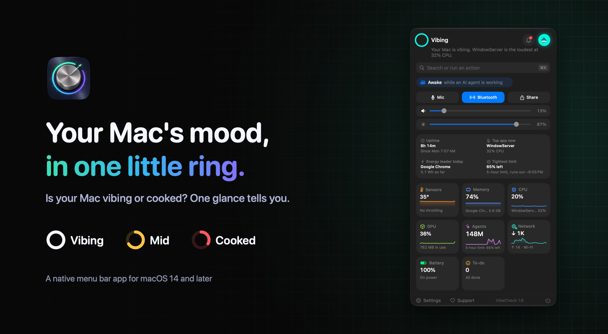</p>

<p align="center">
  <a href="#install">
    
  </a>
  <br>
  <sub>Free and open source (GPL-3.0) · macOS 14 Sonoma or later ·
  <a href="https://github.com/saroj-shahi/vibecheck/releases/latest">release notes</a></sub>
</p>

---

## Meet VibeCheck

Your fan starts screaming. The battery drops faster than it should. Everything feels slow, and you have no
idea why. Normally you'd open a process list and squint at a wall of numbers.

**VibeCheck does the squinting for you.** One small ring sits in your menu bar and shows you how your Mac is
doing at a glance:

| | |
|---|---|
| 🟢 **Vibing** | All good. Get on with your day. |
| 🟡 **Mid** | Something is working hard. Worth a look. |
| 🔴 **Cooked** | Your Mac is struggling, and VibeCheck tells you who's to blame. |

Click the ring and you get the answer in plain words, like _"Kinda mid: Xcode is the loudest at 140% CPU"_,
with a button to quit the app that's causing it.

### Why you'll like it

- **Answers, not numbers.** Every view starts with one sentence about what's going on. The charts are there
  when you want them.
- **Find the culprit in one click.** See which app is eating your battery, memory or bandwidth, and quit it
  right there.
- **Your Mac stays awake when you need it.** Downloads, long exports, presentations, AI agents running
  overnight: tap the cup and your Mac won't nod off. It even goes back to normal on its own.
- **Calm during calls.** When your camera or mic is on, VibeCheck keeps quiet and keeps the screen on.
- **Heads-ups, only when it matters.** Set alerts in plain sentences: _"Tell me when the battery is below 20%."_
- **See how much your AI tools are using.** It counts the tokens Claude Code, Codex and others use each day, and shows how close you are to their limits.
- **Weather, world clocks and widgets** too, so the menu bar you already look at becomes more useful.
- **Private by design.** No account, no tracking, no cloud. Everything stays on your Mac.
- **Made for the Mac.** Fast, light on battery, and at home in macOS, with glass panels, keyboard shortcuts,
  Shortcuts and Siri.

---

## Contents

- [Install](#install)
- [Getting started](#getting-started)
- [How to use each feature](#how-to-use-each-feature)
  - [The vibe ring](#the-vibe-ring) · [The deck](#the-deck) · [Command palette (⌘K)](#command-palette-k) ·
    [Modules](#modules) · [Keep awake](#keep-awake) · [Alerts and notifications](#alerts-and-notifications) ·
    [Call guard and Focus](#call-guard-and-focus) · [AI agents](#ai-agents) · [Desktop widgets](#desktop-widgets) ·
    [Shortcuts, Spotlight and Siri](#shortcuts-spotlight-and-siri) · [Settings](#settings) ·
    [Keyboard shortcuts](#keyboard-shortcuts) · [Updates](#updates)
- [Privacy](#privacy)
- [Develop](#develop) · [Brand](#brand) · [License](#license) · [Roadmap](#roadmap)

## Install

VibeCheck installs from the Terminal. It's free and not notarized by Apple, and a Terminal download doesn't get
the "downloaded from the internet" flag, so macOS opens it without any extra steps.

**With Homebrew** (recommended):

```bash
brew install --cask saroj-shahi/tap/vibecheck
```

**Without Homebrew:**

```bash
curl -fsSL https://raw.githubusercontent.com/saroj-shahi/vibecheck/main/scripts/install.sh | bash
```

The script downloads the latest `VibeCheck.zip` from this repository's releases, checks its SHA-256 checksum,
and puts VibeCheck in Applications. It's short, so you can [read it first](scripts/install.sh).

Then look for the ring in your menu bar (there's no Dock icon). Optional: turn on **Launch at login** in
Settings → General.

**Update:** run `brew upgrade --cask vibecheck`, or run the curl line again. VibeCheck tells you when a new
version is out.

**Uninstall:** run `brew uninstall --cask vibecheck` (add `--zap` to remove settings too), or
`curl -fsSL https://raw.githubusercontent.com/saroj-shahi/vibecheck/main/scripts/install.sh | bash -s -- --uninstall`.

## Getting started

1. **Glance at the ring** in the menu bar. Full and monochrome means your Mac is vibing.
2. **Click it** to open the deck: one line telling you how your Mac is doing, and a live tile per stat.
3. **Click a tile** to see the detail and which apps are responsible.
4. **Press ⌘,** to pick what shows in the menu bar.

## How to use each feature

### The vibe ring

The ring sums up your Mac in one glance:

| Ring | State | Means |
|---|---|---|
| Full, monochrome | **Vibing** | All good |
| Two-thirds, yellow | **Mid** | Something is busy: sustained CPU, memory pressure, heat, low disk or battery |
| One-third, red | **Cooked** | Something needs you: thermal throttling, very high pressure, critical battery |

- **Hover** it for the verdict, e.g. _"Kinda mid: CPU has been busy at 72%."_ On mid or cooked a badge
  names the culprit beside it ("CPU 96%").
- **Click** to open the deck. **⌥-click** toggles keep awake.
- **Drop a file or folder** on it to stay awake until the file stops changing (handy for downloads and
  exports); **drop an app** to stay awake while that app runs.
- When things recover, a check sweeps through the ring's gap. States change only after two samples in a
  row, so nothing flickers.
- Prefer numbers? Show any stat as its own menu bar item, as a graph, an icon or a value:

<p align="center"></p>

### The deck

The glass panel that opens under the menu bar.

<table align="center"><tr>
  <td align="center">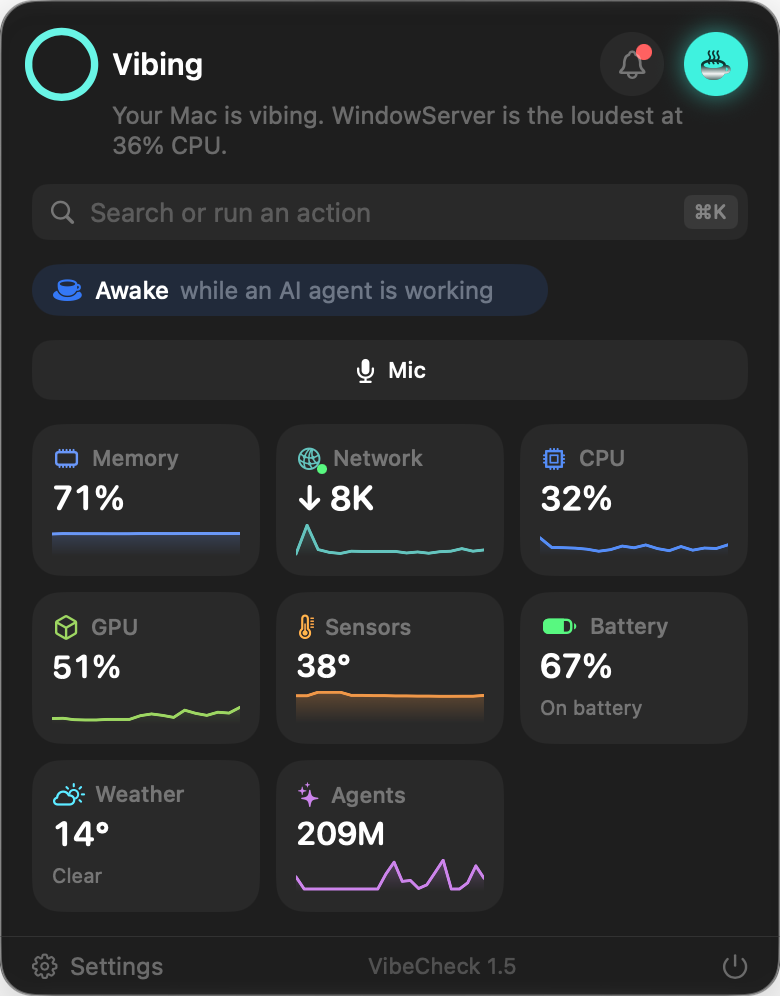<br><sub>The deck: verdict first, then a tile per stat</sub></td>
  <td align="center"><br><sub>⌘K: every action is a command</sub></td>
</tr></table>

- **The verdict line** on top says what's going on and who is the loudest app.
- **Tiles** show each module live. Click one (or use the arrow keys and Return) and it unfolds into the
  module's detail view; **Esc** folds back, then closes. **⌘1…⌘9** jump between modules.
- **Detail views** lead with one big number and a summary, then a chart, then **who's responsible** (top
  apps), with everything else behind a remembered **Details** toggle. Hover a chart to scrub it, switch
  **Live / 1H / 24H**. History survives restarts; sleep shows as gaps.
- **Quit or force quit** a top app straight from its row (asks first). ⌘↩ runs a tile's main action.
- **The cup** is keep awake (see below); **the bell** lists the last 20 alerts, with a red dot for unseen
  ones; **the gear** opens Settings.
- **Mic mute** is one click in the deck; **Empty Trash** lives in the palette.

### Command palette (⌘K)

Open the deck and press **⌘K**, or just start typing. Everything VibeCheck can do is a command: open a
module, start or stop keep awake, mute the mic, **Empty Trash** (press ↩ twice), **Quit /
Force Quit** one of the top 3 apps by CPU, turn an alert on or off, **Check for Updates**. The last 8
commands you ran come first.

### Modules

Turn each one on or off in Settings (new installs start with CPU, Memory, Network, Sensors, Battery and
Agents). Every detail view follows the same order: the big number, a chart, then who's responsible.

<table align="center">
<tr>
  <td align="center">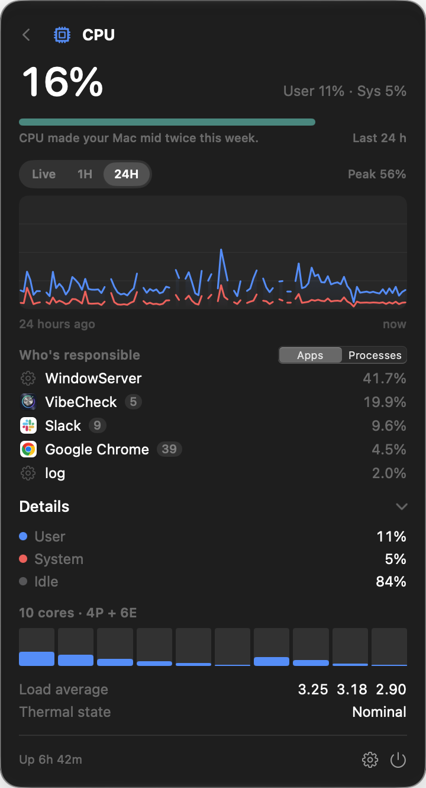<br><sub>CPU</sub></td>
  <td align="center">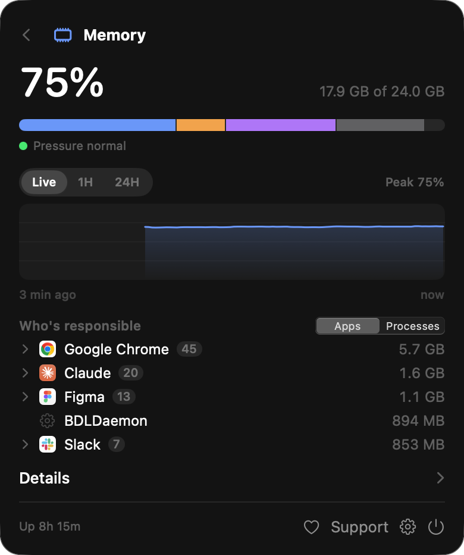<br><sub>Memory</sub></td>
  <td align="center">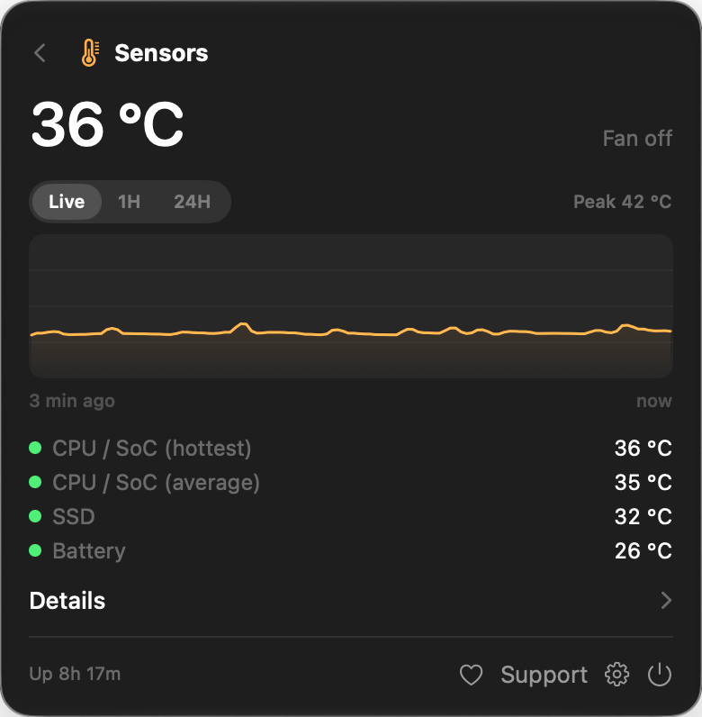<br><sub>Sensors</sub></td>
</tr>
<tr>
  <td align="center">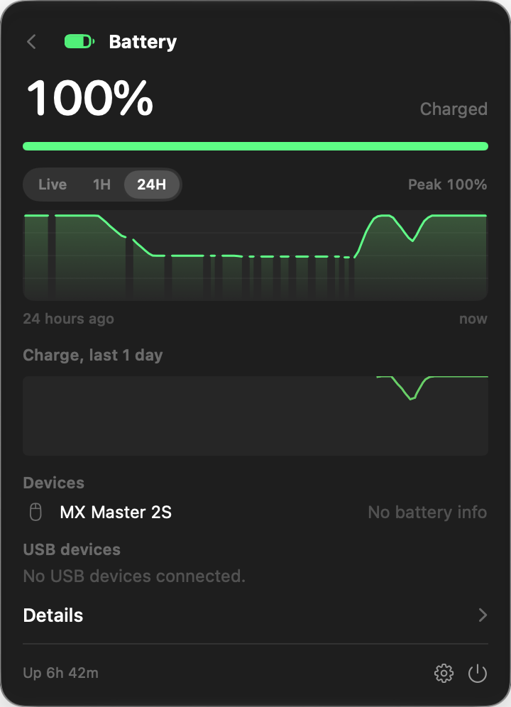<br><sub>Battery</sub></td>
  <td align="center">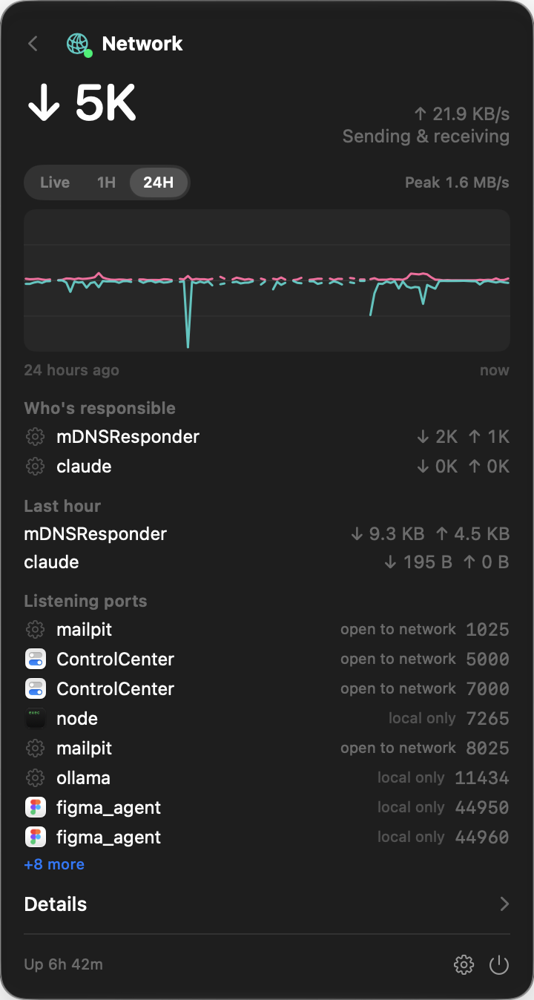<br><sub>Network</sub></td>
  <td align="center">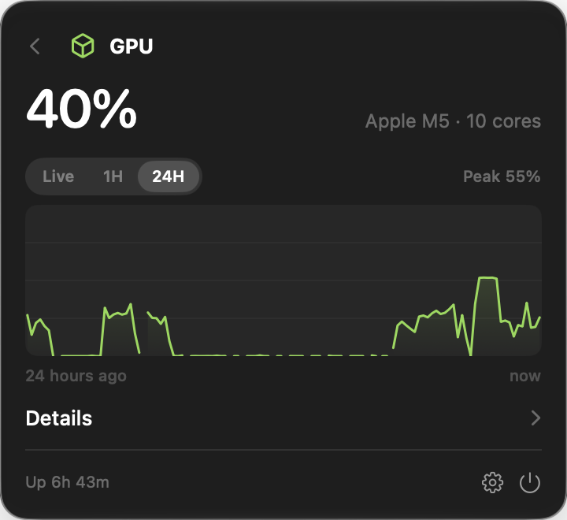<br><sub>GPU</sub></td>
</tr>
</table>

| Module | Menu bar | Detail view |
|---|---|---|
| CPU | mini history bars + % | user/system split, per-core bars, P/E cores, load average, thermal state, top apps, **vibe replay** (24 h vibe strip, "X cooked your Mac N times this week") |
| GPU | mini history bars + % | utilization, renderer/tiler split, GPU memory, model and cores |
| Memory | pressure-colored gauge + % | app/wired/compressed/cached breakdown, pressure, swap, top apps |
| Network | ↑/↓ rates, "Offline" when disconnected | per-interface traffic, Wi-Fi details, local IP (public IP opt-in), top apps by traffic, listening ports |
| Disk | read/write rates | I/O graph, every local volume with free space, connected USB devices |
| Sensors | hottest temperature | SoC, SSD and battery temperatures, fan speed, system and adapter power |
| Battery | icon + % | state, time left, power draw, health, cycles, 90-day charge and capacity history, Bluetooth device batteries |
| Weather | condition + temperature | now, next 12 hours, 7 days ([Open-Meteo](https://open-meteo.com/); pick a city, no location access) |
| Agents | agent logo + tokens today | see [AI agents](#ai-agents) |
| Clock | time | date, month calendar, world clocks with day/night and offset |

### Keep awake

Stops your Mac from idle-sleeping, like `caffeinate`.

- **Start it:** click the cup in the deck, ⌥-click the ring, press **⌃⌥⌘A** from any app, or use Shortcuts.
- **Choose how long:** drag around the cup's **hold dial** (15 min / 1 h / 4 h / ∞), or use the cup menu for
  a length, a time of day, or **while an app is running**.
- **Automatic triggers** (Settings → Keep Awake): while plugged in, while an external display is connected,
  while on a chosen Wi-Fi network (asks for Location only when you turn it on), on a schedule, while files
  are downloading, while an AI agent is working, or when VibeCheck opens.
- While it's on, a small cup sits inside the ring (or as its own menu bar item, if you prefer).
  Sessions stop on their own on low battery and send a notification when they end by themselves.

<p align="center">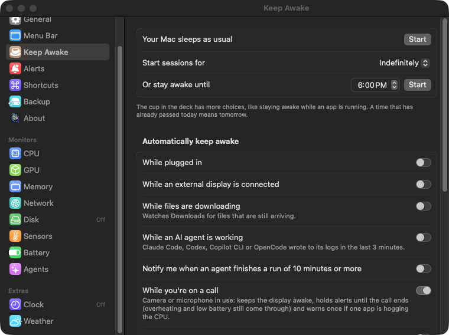</p>

### Alerts and notifications

Rules read as sentences in Settings → Alerts: _Tell me when **CPU usage** is **above** **90%** for **1 min**._

- Click any bold word to change it; drag the number sideways to adjust it; preview the banner.
- Each module's page in Settings also lists that module's alerts.
- The deck's **bell** keeps the last 20 alerts and keep-awake endings with time and value.

<p align="center">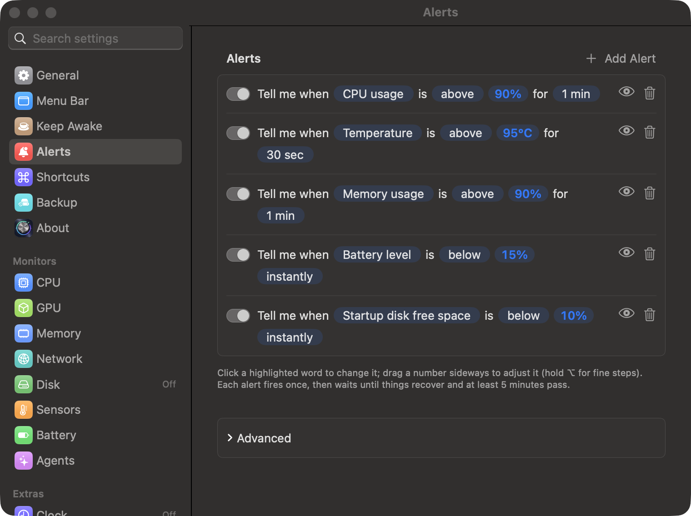</p>

### Call guard and Focus

On by default. When your camera or mic is in use, VibeCheck holds non-critical alerts until the call
ends (temperature and battery still come through), keeps the display awake, and warns once if an app is
burning 100%+ CPU, with a Quit button.

For more control per Focus, go to System Settings → Focus → pick a Focus → **Add Filter** → VibeCheck, and
choose "Hold alerts" and / or "Keep display awake".

### AI agents

The Agents module reads **local logs only** (nothing is sent anywhere) from Claude Code, Codex, Copilot CLI
and OpenCode:

- Tokens today, the last 24 h by hour, a 7-day chart, busiest projects and per-model split.
- Usage limits: Codex limits, and Claude's current 5-hour window (estimated, or live through your own
  `claude` CLI).
- **Several Claude accounts?** Pick which one in Settings → Agents (auto-found `~/.claude-*` folders, or
  "Choose account folder…").
- **Agent watch:** keep your Mac awake while an agent is working, and get an "<Agent> is done"
  notification after runs of 10 minutes or more.
- Switch agents you don't use off in Settings → Agents; they disappear everywhere.

<p align="center">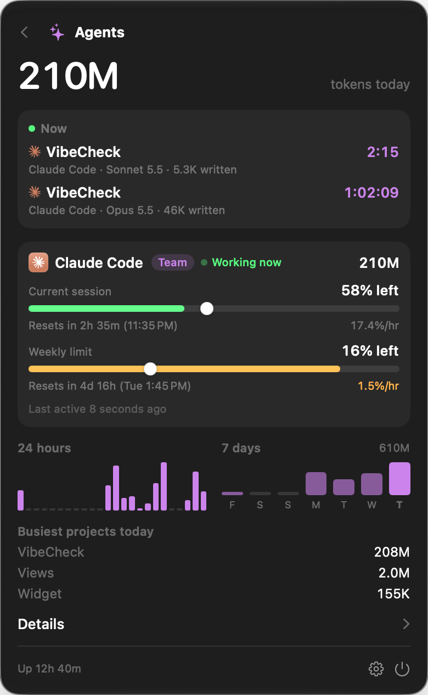</p>

### Desktop widgets

Right-click the desktop → **Edit Widgets** → search "VibeCheck":

- **Vibe** (small): the ring, the vibe word and the reason.
- **CPU and Memory** (medium): the ring, the verdict and last-hour sparklines.

Widgets update while VibeCheck runs and dim if it has been quit for a while.

### Shortcuts, Spotlight and Siri

The Shortcuts app gets **Get Mac Vibe**, **Get Mac Stat** (CPU, GPU, memory, free disk, download/upload
speed, hottest temperature, battery, agent tokens today), **Open VibeCheck Deck** (optionally on a module),
**Keep Mac Awake** (for N minutes or until stopped) and **Let Mac Sleep**. Several also work from Spotlight
and Siri, e.g. _"Keep my Mac awake with VibeCheck"_.

### Settings

Open with the gear in the deck, **⌘,**, or by opening the app again. A searchable sidebar groups the pages:

- **General:** update interval, launch at login, turn Bluetooth off while asleep (Advanced).
- **Menu Bar:** a live preview with your real stats. Choose **Just the vibe ring** (default), separate items
  or **one combined item**; spacing; colorful or single-color graphs; drag to reorder; per-item style (graph,
  icon or value). **Fit around the camera notch** shows only what fits beside the notch plus a "+N" badge.
- **One page per module:** on/off, how it looks in the menu bar, its alerts and its shortcut.
- **Keep Awake**, **Alerts**, **Agents**, **Clock** (formats, seconds, world clocks), **Weather** (city, °C / °F).
- **Shortcuts:** global hotkeys (see below).
- **Backup:** export, import or reset settings.
- **About:** version and the update check.

Less-used options sit under each page's **Advanced** section.

<p align="center">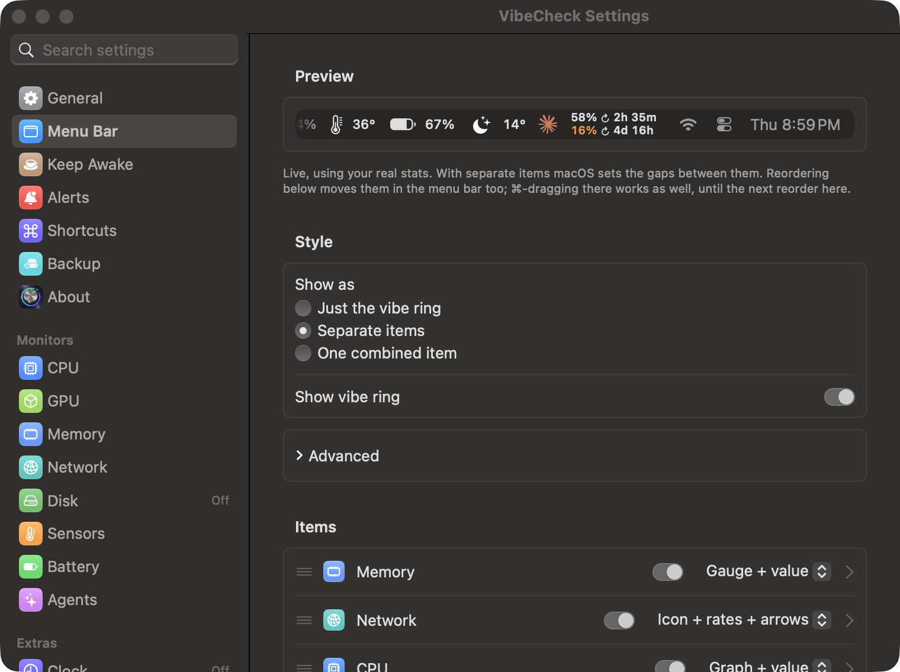</p>

### Keyboard shortcuts

| Shortcut | Where | Does |
|---|---|---|
| `⌃⌥⌘1`…`⌃⌥⌘9`, `⌃⌥⌘0` | anywhere | open the deck on a module |
| `⌃⌥⌘A` | anywhere | toggle keep awake |
| `⌘K` or start typing | deck | command palette |
| `⌘1`…`⌘9` | deck | jump to a module |
| arrows, `↩` | deck | move between tiles, open one |
| `⌘↩` | deck | run the tile's action |
| `Esc` | deck | fold back, then close |
| `⌘,` | deck | Settings |

If another app is using secure input (a password field, some terminals), global shortcuts pause and the
deck says so.

### Updates

VibeCheck checks this repository's latest release at most once a day and sends one notification per new
version, with the command to update (`brew upgrade --cask vibecheck` or the install line). Check now from
Settings → About or ⌘K → "Check for Updates", or turn the check off there.

## Privacy

Everything is read on your Mac. VibeCheck has no account, no analytics and no server. The only network
calls are the weather (Open-Meteo, for the city you pick), the update check (GitHub), and the public IP
(api.ipify.org) only if you turn it on. Details are in [PRIVACY.md](PRIVACY.md).

## Develop

```bash
./build.sh                  # builds build/VibeCheck.app (--install copies it to /Applications)
swift test                  # the unit tests: alerts, history, charts, layout, vibe score, notch fit, backup…
swift build && .build/debug/VibeCheck --dump    # print one sample from every monitor
build/VibeCheck.app/Contents/MacOS/VibeCheck --deck-demo   # open the deck and log its frames
/Applications/VibeCheck.app/Contents/MacOS/VibeCheck --login-item on   # launch at login (or off / status)
```

**Making a release:** bump the version in `Resources/Info.plist`, then run `scripts/release.sh --zip`. It builds
`build/release/VibeCheck.zip` and its `.sha256`, and prints the tag, `gh release create` and Homebrew cask
lines. Tags are `v<version>`, and every release must carry `VibeCheck.zip` and `VibeCheck.zip.sha256`: the
install script, the cask and the in-app update check all read those. The DMG modes (`--share`, and plain
`scripts/release.sh` for a notarized build with a Developer ID) are kept for later.

See [CONTRIBUTING.md](CONTRIBUTING.md) to send a change.

| Folder | What's inside |
|---|---|
| `Sources/VibeCheck/Monitors/` | Data collectors: Mach host stats, sysctl, IOKit, IOPowerSources, SMC, HID sensors, `ps`, `nettop` |
| `Sources/VibeCheck/App/` | `SystemStats`, settings, the deck controller, vibe score, alerts, history, weather, hotkeys |
| `Sources/VibeCheck/Views/` | Menu bar labels, deck, detail panels, charts, settings window |
| `branding/` | Brand guide, SVG sources, rendered PNGs and the DMG art |
| `scripts/` | `release.sh` (zip / DMG), `install.sh` (Terminal install and update), `render_brand.swift` (icon and brand assets), `render_dmg.swift` (install window art), `render_hero.swift` (the README hero), `render_ring_symbol.swift` (the ring's custom SF Symbols) |

See [`docs/CODEMAP.md`](docs/CODEMAP.md) for which file does what.

## Brand

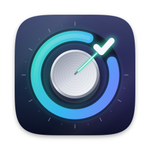

The mark is a **mood dial**: the **vibe ring** as its track, a knob pointing at the ring's gap and a
**check** in that gap: your Mac, dialled to vibing. The palette runs **Mint → Sky → Violet** on deep **Ink** and **Night**;
the wordmark is SF Pro Rounded Bold with "Check" in the gradient. Voice: casual and honest, slang only for
**vibing, mid, cooked**.

<br clear="left">

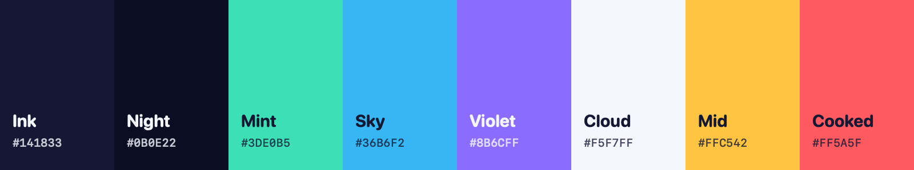

<p align="center">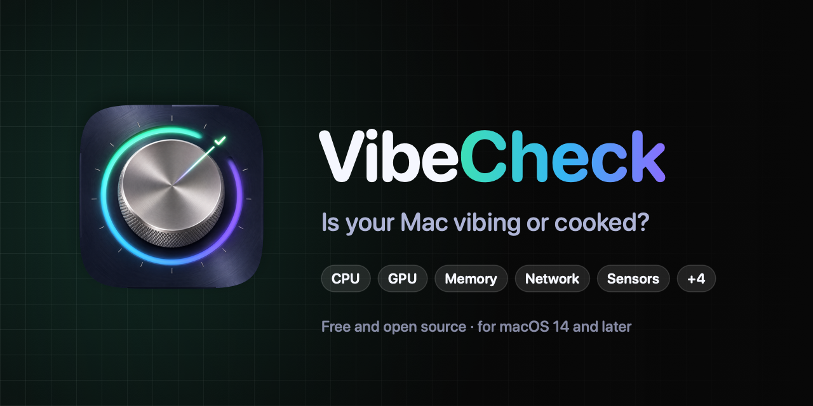</p>

The full guide (logo usage, clear space, color roles, type, voice, motion) is in
[`branding/BRAND.md`](branding/BRAND.md). All artwork is generated from SVG:

```bash
swift scripts/render_brand.swift   # rewrites branding/png/* and Resources/AppIcon.icns
```

## License

VibeCheck is free software: you can redistribute it and/or modify it under the terms of the
[GNU General Public License v3.0](LICENSE) or (at your option) any later version. If you share a modified
version, you must share its source under the same license.

**No warranty.** VibeCheck is provided "as is", without warranty of any kind, and the author isn't liable for
any damage from using it (GPL-3.0 sections 15 and 16). It reads some undocumented macOS interfaces (SMC
sensors, HID temperature sensors, Bluetooth power), and can turn Bluetooth off, keep your Mac awake, empty the
Trash or quit apps when you ask it to. Use those features at your own risk.

The VibeCheck name, icon and artwork aren't covered by the code license; forks must use their own. See
[TRADEMARKS.md](TRADEMARKS.md). Third-party credits are in [NOTICE](NOTICE). VibeCheck isn't affiliated with
Apple, Anthropic, OpenAI, GitHub or opencode.

Copyright © 2026 Saroj Shahi.

## Roadmap

Features by priority, what has shipped, what's been verified, the design rules, known limits and the
decisions log live in [`docs/ROADMAP.md`](docs/ROADMAP.md).
