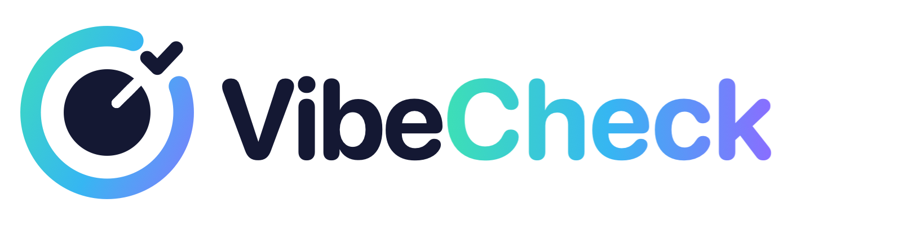

<p align="center">
  <picture>
    <source media="(prefers-color-scheme: dark)" srcset="branding/png/lockup-dark.png">
    
  </picture>
</p>

<p align="center"><b>Is your Mac vibing or cooked?</b><br>
A native menu bar system monitor for macOS 14+, written in Swift with SwiftUI and AppKit.</p>

<p align="center"></p>

---

## What it does

VibeCheck sums up your Mac in one glance and explains it in one click.

- **The vibe ring** lives in your menu bar: full and monochrome while your Mac is **vibing**, two-thirds
  and yellow when it's **mid**, one-third and red when it's **cooked** (sustained CPU, memory pressure,
  heat, low disk or battery, thermal throttling). States change only after two consecutive samples, so
  nothing flickers.
- **The deck** opens under the menu bar: a glass panel with a live tile per stat and a one-line verdict,
  e.g. _"Kinda mid: CPU has been busy at 72%. Xcode is the loudest at 140% CPU."_ Click a tile (or use the
  arrow keys and Return) and it unfolds into that module's detail view. Esc folds back, then closes.
  `⌘1`–`⌘9` jump between modules, `⌘,` opens Settings.
- **Keep awake** (like `caffeinate`): the cup in the deck keeps your Mac from idle-sleeping
  indefinitely, for 15 min to 5 hours, until a time of day, or while an app is running. It can also switch
  on by itself while plugged in or while an external display is connected. `⌃⌥⌘A` toggles it from any app,
  sessions stop by themselves on low battery, and you get a notification when one ends on its own. A small
  cup sits in the menu bar while it's on.
- **Notification history:** the bell in the deck lists the last 20 alerts and keep-awake endings with
  time and value; a red dot means there's something you haven't seen.
- **Detail views** lead with one big number and a summary, then a chart, then **who's responsible** (top
  apps), with everything else behind a remembered **Details** toggle. Hover any chart to scrub it; switch
  **Live / 1H / 24H** and the line morphs. History survives restarts (sleep shows as gaps).

## Modules

| Module | Menu bar | Detail view |
|---|---|---|
| CPU | mini history bars + % | user/system split, per-core bars, P/E cores, load average, thermal state, top apps |
| GPU | mini history bars + % | utilization, renderer/tiler split, GPU memory, model and cores |
| Memory | pressure-colored gauge + % | app/wired/compressed/cached breakdown, pressure, swap, top apps |
| Network | ↑/↓ rates that light up with traffic, "Offline" when disconnected | status, per-interface traffic, local IP, totals, top apps by traffic |
| Disk | read/write rates | I/O graph, every local volume with free space |
| Sensors | hottest temperature | SoC, SSD and battery temperatures, fan speed, system and adapter power, every sensor |
| Battery | icon + % | state, time remaining, power draw, health, cycles, Bluetooth device batteries |
| Weather | condition + temperature | now, next 12 hours, 7 days ([Open-Meteo](https://open-meteo.com/); city search, no location access) |
| Agents | ✨ + tokens today | Claude Code and Codex tokens today, last 24 h by hour, current 5-hour window (Claude, estimated), Codex usage limits, busiest projects, per-model split (read from local logs only) |
| Clock | time | date, month calendar, world clocks with day/night and offset |

## Shortcuts, Spotlight and Siri

VibeCheck adds actions to the Shortcuts app: **Get Mac Vibe**, **Get Mac Stat** (CPU, GPU, memory, free disk,
download/upload speed, hottest temperature, battery, agent tokens today), **Open VibeCheck Deck** (optionally on
a module), **Keep Mac Awake** (for N minutes or until stopped) and **Let Mac Sleep**. Four of them also work
from Spotlight and Siri, e.g. _"Keep my Mac awake with VibeCheck"_.

## Settings

Open from the gear in the deck, `⌘,`, or by opening the app again.

- **Menu Bar:** a live preview drawn with your real stats; separate items or **one combined item**;
  spacing (normal / compact / tight); vibe ring; colorful or single-color graphs; drag to reorder; per-item
  style (graph, icon or value only). **Fit around the camera notch** shows only what fits beside the notch
  (or at most _N_ stats) plus a "+N" badge.
- **General:** update interval, launch at login.
- **Keep Awake:** start/stop, default length, stay awake until a time, automatic triggers (plugged in,
  external display), keep the display on, stop on battery below _N_%, start when VibeCheck opens,
  notification on end, `⌃⌥⌘A` shortcut, cup in the menu bar.
- **Alerts:** rules that read as sentences: _Tell me when **CPU usage** is **above** **90%** for **1 min**._
  Click a word to change it, drag the number sideways to adjust it, preview the banner.
- **Clock:** locale-aware formats, seconds, world clocks.
- **Weather:** city search, °C / °F.
- **Shortcuts:** `⌃⌥⌘1`…`⌃⌥⌘9` and `⌃⌥⌘0` open each module from any app; `⌃⌥⌘A` toggles keep awake.
- **Backup:** export, import or reset settings.

## Install

```bash
./build.sh --install                                                   # builds and copies to /Applications
/Applications/VibeCheck.app/Contents/MacOS/VibeCheck --login-item on   # launch at login (or off / status)
```

The app is signed locally (ad hoc). On another Mac, right-click it and choose **Open** the first time.

## Develop

```bash
./build.sh                  # builds build/VibeCheck.app
swift test                  # 40+ tests: alerts, history, charts, layout, vibe score, notch fit, backup…
swift build && .build/debug/VibeCheck --dump    # print one sample from every monitor
build/VibeCheck.app/Contents/MacOS/VibeCheck --deck-demo   # open the deck and log its frames
```

| Folder | What's inside |
|---|---|
| `Sources/VibeCheck/Monitors/` | Data collectors: Mach host stats, sysctl, IOKit, IOPowerSources, SMC, HID sensors, `ps`, `nettop` |
| `Sources/VibeCheck/App/` | `SystemStats`, settings, the deck controller, vibe score, alerts, history, weather, hotkeys |
| `Sources/VibeCheck/Views/` | Menu bar labels, deck, detail panels, charts, settings window |
| `branding/` | Brand guide, SVG sources and rendered PNGs |
| `scripts/` | `render_brand.swift`: renders the app icon (from the render in `branding/art`) and every brand asset (from SVG) |

## Brand


The mark is a **mood dial**: the **vibe ring** as its track, a knob pointing at the ring's gap and a
**check** in that gap: your Mac, dialled to vibing. The palette runs **Mint → Sky → Violet** on deep **Ink** and **Night**;
the wordmark is SF Pro Rounded Bold with "Check" in the gradient. Voice: casual and honest, slang only for
**vibing, mid, cooked**.

<br clear="left">


The full guide (logo usage, clear space, color roles, type, voice, motion) is in
[`branding/BRAND.md`](branding/BRAND.md). All artwork is generated from SVG:

```bash
swift scripts/render_brand.swift   # rewrites branding/png/* and Resources/AppIcon.icns
```

## Roadmap

Features by priority, what has shipped, what's been verified, the design rules, known limits and the
decisions log live in [`docs/ROADMAP.md`](docs/ROADMAP.md).
