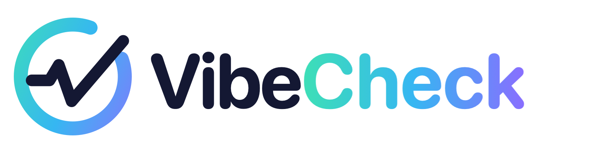
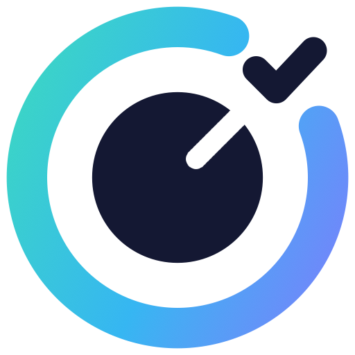
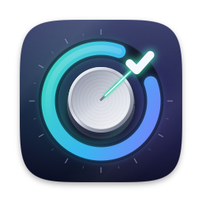
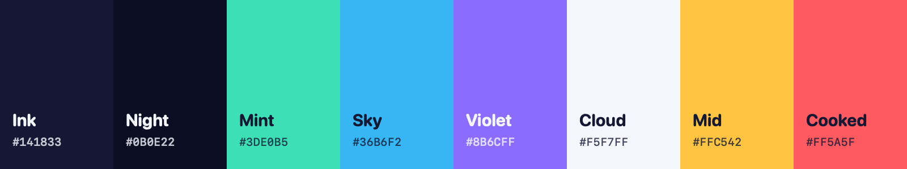

<p align="center">
  <picture>
    <source media="(prefers-color-scheme: dark)" srcset="png/lockup-dark.png">
    
  </picture>
</p>

# VibeCheck brand guide

Everything you need to present VibeCheck consistently: the idea behind it, the logo and app icon, color,
type, voice and motion. All artwork is generated from the SVG sources in [`svg/`](svg/) by
[`scripts/render_brand.swift`](../scripts/render_brand.swift), so a change to a source file plus one command
updates every asset.

```bash
swift scripts/render_brand.swift   # from the repo root; rewrites branding/png/* and Resources/AppIcon.icns
```

---

## 1. The idea

**VibeCheck answers one question: _is your Mac vibing or cooked?_**

System monitors usually hand you a wall of numbers. VibeCheck gives you a verdict first and the numbers
when you want them. The brand follows the same rule: calm and confident on the surface, precise underneath.

- **Personality:** chill, sharp, a little playful. Like a friend who's good with computers.
- **Promise:** one glance tells you whether to care. One click tells you why.
- **Vocabulary:** the Mac is **vibing** (all good), **mid** (worth a look) or **cooked** (act now).

## 2. Logo

### The mark



The mark is the app's **vibe ring** with a **pulse line that turns into a check mark** and breaks out
through a gap in the ring. Pulse = monitoring; check = verdict; the ring = your Mac's overall health.

- The ring is a 310° arc with round caps. Its gap sits at about 1–2 o'clock, exactly where the check exits.
- The ring uses the brand gradient (Mint → Sky → Violet). The pulse/check is a single solid stroke.
- On dark backgrounds the pulse/check is **Cloud** (`#F5F7FF`); on light backgrounds it's **Ink** (`#141833`).

### Variants

| Asset | File | Use for |
|---|---|---|
| App icon | `svg/icon.svg` → `png/icon-*.png`, `Resources/AppIcon.icns` | Dock, Finder, Launchpad, About |
| App icon, small sizes | `svg/icon-small.svg` | 16 and 32 px only (thick ring, plain knob, bold check; no ticks or glow) |
| Mark on dark | `svg/mark-on-dark.svg` | Dark UI, slides, social |
| Mark on light | `svg/mark-on-light.svg` | Light UI, docs, print |
| Mark, monochrome | `svg/mark-mono.svg` | Single-color contexts, embossing, template images |
| Lockup (light / dark) | `png/lockup-light.png`, `png/lockup-dark.png` | README and web headers |
| Social card | `png/social-card.png` (1280 × 640) | GitHub social preview, link unfurls |

### Wordmark

**Vibe**Check is set in **SF Pro Rounded Bold** with slight negative tracking (−2%). "Vibe" is solid
(Ink or Cloud); "**Check**" carries the brand gradient. Always one word, capital V and C: _VibeCheck_,
never "Vibe Check", "vibecheck" or "VIBECHECK" (except where a system forces lowercase, like the repo
name).

### Clear space and minimum size

- Keep clear space around the mark equal to **the ring's stroke width** (about 12% of the mark's size).
- Keep clear space around the lockup equal to **the height of the "V"**.
- Minimum sizes: mark **16 px** (use the small-size art), lockup **24 px tall**.

### Don't

- Recolor the ring with anything other than the gradient (or the single color of the mono mark).
- Close the ring's gap, move it, or let the check stay inside the ring.
- Add effects (bevels, outer glows, drop shadows) to the mark outside the app icon.
- Stretch, rotate or outline the wordmark, or put the gradient on "Vibe".
- Place the gradient mark on busy photos; use the mono mark instead.

## 3. App icon



- **Concept, "Mood Dial":** your Mac's vibe as a machined volume knob. The ring becomes the dial's lit
  track, the knob's pointer runs out to the gap, and the check breaks out through it: the dial is turned
  to "vibing." Same ring, gap and check as the mark, built as an object you'd want to touch.
- **Shape:** macOS's continuous-corner rounded square on the standard 824/1024 grid, with a soft drop
  shadow baked in, as macOS icons expect.
- **Layers, back to front:** anodized navy plate (Dusk → Night with faint diagonal brushing and mint /
  violet glows) · etched scale ticks (none in the gap) · dark groove · gradient ring with a soft bloom and a
  top highlight · knob shadow · knurled side with mint spill · machined silver cap with a concave dish and
  a 1px rim bevel · engraved pointer with a mint light line · Cloud check with mint glow · top gloss ·
  hairline edge. Glows are clipped to the plate.
- **Liquid Glass (macOS 26+):** `VibeCheck.icon` (Icon Composer; Dusk → Night fill, flat layers, no baked
  effects) in three depth groups, front to back: knob (check with mint pointer line, glass cap, ridged
  side) · ring (glass) · plate engraving (ticks, groove). Compiled by `build.sh` into `Assets.car`;
  macOS 14–15 use `AppIcon.icns`.
- **Small sizes:** at 16 and 32 px the icon switches to `icon-small.svg`: a thicker ring, a plain silver
  knob and a bold Ink check on it, because ticks, knurling and the pointer turn to mush that small.
- **Source:** the SVGs are plain shapes and gradients (NSImage's SVG renderer draws them); edit them
  directly, then run `render_brand.swift`.

## 4. Color



| Name | Hex | Role |
|---|---|---|
| **Ink** | `#141833` | Primary text on light; the "Vibe" in the light wordmark |
| **Night** | `#0B0E22` | Deepest background; bottom of the icon gradient |
| **Dusk** | `#252A52` | Top of the icon / dark-surface gradient |
| **Mint** | `#3DE0B5` | Brand accent, start of the gradient, the **vibing** state |
| **Sky** | `#36B6F2` | Middle of the gradient, links and data accents |
| **Violet** | `#8B6CFF` | End of the gradient, highlights |
| **Cloud** | `#F5F7FF` | Text and the pulse/check on dark |
| **Haze** | `#AEB4D6` | Secondary text on dark |
| **Mid** | `#FFC542` | The **mid** state in marketing |
| **Cooked** | `#FF5A5F` | The **cooked** state in marketing |

- **The brand gradient** runs Mint → Sky → Violet at about 135° (top-left to bottom-right). Use it for the
  ring, the word "Check" and at most one other hero element per layout.
- **In the app,** state colors use the system `mint`, `yellow` and `red`, and module accents use system-
  adaptive colors. They adjust for light/dark mode and Increase Contrast; the brand hex values above are
  for marketing and artwork.
- **Menu bar:** monochrome by default, as macOS expects; color appears only when the state isn't vibing.

## 5. Typography

| Role | Typeface | Notes |
|---|---|---|
| Wordmark, display, hero numbers | SF Pro Rounded, Bold / Semibold | Tracking −0.6 at 34 pt, −2% for the wordmark |
| UI text | SF Pro Text, Regular / Medium | 13 pt body, 11 pt semibold section labels in sentence case |
| Numbers | SF Pro with **monospaced digits** | Values never jiggle as they change |
| Code and hex values | SF Mono | Docs only |

On the web or in documents without SF Pro, fall back to `ui-rounded, "SF Pro Rounded", system-ui`.

## 6. Voice and tone

Casual, quick and honest. Gen Z flavor in the **headlines and verdicts**; plain English everywhere that
needs to be precise.

| Do | Don't |
|---|---|
| "Your Mac is vibing. Chrome is the loudest at 12% CPU." | "System resources nominal." |
| "Kinda mid: memory is getting tight." | "Bestie your RAM is giving ✨struggle✨" |
| "Your Mac is cooked: it's running hot at 94 °C." | "CRITICAL THERMAL EVENT DETECTED" |
| "CPU usage has been above 90% for 1 min. Now 96%." (alerts) | Slang in alerts, errors or settings labels |

- Lead with the verdict, then the reason, then the culprit.
- Use real numbers with units. Round to what matters.
- Slang lives in three words: **vibing, mid, cooked**. Everything else is clear, friendly English.
- Never blame the user. Name the app or the condition, not the person.

## 7. Motion

Motion explains what changed; it never decorates.

| Moment | Motion |
|---|---|
| Tile → detail | Matched-geometry unfold, spring response 0.38, damping 0.86; neighbors fade and shrink to 96%, staggered 25 ms by distance |
| Vibe change | Ring fill and color animate (spring 0.5 / 0.75) with one small bounce; needs two consecutive samples first |
| Range switch | The chart line morphs between ranges; the pill slides (spring 0.3 / 0.8) |
| Press | 97% scale, spring 0.2 / 0.7 |
| Tile hover | Fill 55% → 90%, a chevron fades in at the top right (150 ms ease-out) |
| Palette selection | 14% accent fill moves to the row, ↩ replaces its shortcut (120 ms ease-out) |
| Reduce Motion | Every spring becomes a 150 ms crossfade |

## 8. Asset checklist

- [x] App icon (`.icns` with dedicated small-size art)
- [x] Mark: on dark, on light, monochrome (SVG + PNG)
- [x] Lockups for light and dark backgrounds
- [x] Social card (1280 × 640)
- [x] Palette sheet
